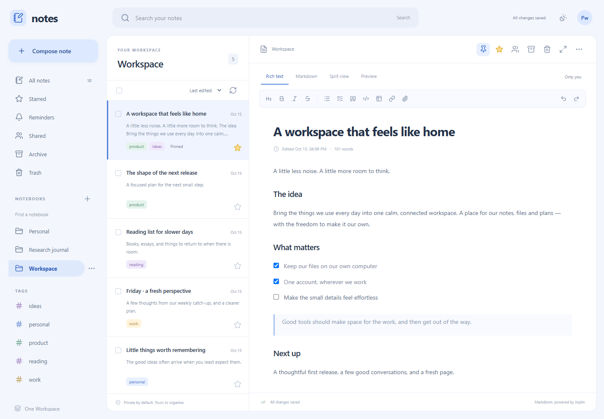

<p align="center">
  
</p>

<h1 align="center">Notes</h1>

Your notes, notebooks and ideas, together in One Workspace. A portable Windows
application with a calm three-column interface, SQLite storage and MyAccounts
sign-in. Uses Joplin's open-source Markdown renderer as its rendering foundation.



**Preview release.** This is a working notes application with tested persistence,
editing, authentication and permissions. It is not full Joplin feature parity.
Official Joplin synchronisation/E2EE, JEX, a Drive picker and direct Calendar API
integration are not implemented. Read [compatibility](docs/JOPLIN.md) and the
[acceptance ledger](docs/ACCEPTANCE.md) before relying on it for important data.

## Download and start

Download `MyNotes.exe` or the portable ZIP from
[Releases](https://github.com/oneworkspacestudio/notes/releases). Check its SHA256
against `SHA256SUMS.txt`. The executable contains the frontend and database driver;
no Docker, Node.js, Python or separate database server is required at runtime.
Use Windows x64. Clean Windows 10/11 acceptance and code signing remain pending.

Extract into a dedicated folder such as `OneWorkspace/Apps/MyNotes/`.

For a personal workspace on this computer, double-click `Start-local.cmd`, or run:

```powershell
.\MyNotes.exe --local
```

Open the **one-time sign-in URL** printed in that window. Local mode binds only
to loopback, uses one local account, and requires that token. Restart to get a new
link after signing out. Keep the window open while using notes; Ctrl+C stops it.

For a shared workspace, copy `config.example.json` to `config.json`, register
an application in MyAccounts, and configure the issuer and client ID. Register
the exact callback `PUBLIC_URL/auth/callback`; supply the client secret only to
the server process using `NOTES_OIDC_CLIENT_SECRET`. Then run:

```powershell
.\MyNotes.exe --config C:\OneWorkspace\Apps\MyNotes\config.json
```

Managed mode never substitutes a local login when MyAccounts is unavailable.
Use HTTPS outside loopback development and an NTFS data folder. See
[configuration](docs/CONFIGURATION.md) for reverse proxies, service installation,
session policy and One Workspace registration.

## What works

- Rich text and Markdown editing, Joplin-powered preview and split view; checklists,
  tables, code blocks, links, quotations, image and file attachments.
- Revision-checked autosave, offline-aware local drafts, recovery and conflict
  copies; up to 50 content revisions per note, with restore.
- Nested notebooks, coloured tag labels, indexed full-text search, sorting,
  pagination, multi-select, pinning, stars, reminders, archive and Trash.
- Templates, duplication and internal Markdown links: `[Title](:/NOTE_ID)`.
- Private notes and optional notebook invitations with viewer/editor permissions,
  expiry, single use and revocation. Sharing applies to that notebook directly;
  child notebooks keep independent permissions.
- Markdown/HTML import, Markdown/HTML export ZIPs, and complete personal JSON/ZIP
  exports with attachments and notebook hierarchy. Full offline system backups
  retain users, history and permissions. Restores invalidate sessions/invitations.
- MyAccounts Authorization Code + PKCE, discovery and verified ID tokens;
  stable issuer/subject provisioning, per-user permissions and fixed session expiry.
- Administration for quotas, disabled accounts, restart-bound configuration,
  audit events, health and version; administrators receive no extra note access.
- Light/dark themes and mobile navigation. Calendar reminders export as `.ics`.

Search results load 100 notes per page. Tags are comma-separated and their colours
are deterministic. Duplicate notes keep attachment references with their original
permissions; export/import makes independent attachment copies. Rich text covers
the common Markdown subset. Keep extended Joplin syntax in Markdown mode.

## Back up your data

Settings → **JSON backup** exports your own notes and attachments. Import restores
them as new copies, with fresh IDs and remapped links. Shared notes owned by other
people are excluded. These personal exports do not include version history.

For a full installation backup, stop notes first:

```powershell
.\MyNotes.exe --config C:\OneWorkspace\Apps\MyNotes\config.json --file C:\Backups\notes.zip backup
.\MyNotes.exe --data C:\RestoredNotes --file C:\Backups\notes.zip restore
```

Use `--local` as well for a local-mode data folder. Restore only into a new,
dedicated destination. Restore configuration and your secret environment
separately, then point `data_dir` at the restored folder. ZIPs contain plaintext
private content: store them in a protected or encrypted backup location.

## Develop

Build requirements: Go **1.27.2**, Node.js **26** and npm. Runtime has no such
requirements. The npm lockfile pins the actual frontend build inputs.

```powershell
./scripts/build.ps1 -BrowserTests
# If Go is outside PATH:
./scripts/build.ps1 -Go C:\Tools\Go\bin\go.exe -BrowserTests
```

Author UI screens in `web/src/Notes.aui` and `Dialog.aui`; `npm run generate`
compiles them to React. Adapter components connect the UI contract to application
state and Tiptap. To develop the frontend, start a local executable on port 8795
and run `npm --prefix web run dev` (use the same origin for authenticated APIs).
For Vite's authenticated development origin, run the backend with
`MyNotes.exe --local --port 8795 --public-url http://127.0.0.1:5173`, then start
Vite and open the printed sign-in link on port 5173. Build the frontend before Go
embeds `web/dist/`.

Validation:

```powershell
go test ./...
go vet ./...
npm --prefix web test
npm --prefix web run test:portable
./scripts/test-myaccounts.ps1 -MyAccountsExe C:\TestTools\MyAccounts.exe
```

Browser tests use installed Chrome. Set `NOTES_CHROME` for another Chromium
executable and `NOTES_TEST_ROOT` to a writable test location. Tests create
disposable data and never target a live identity database. The MyAccounts fixture
requires an NTFS temporary directory and bootstraps two synthetic accounts.

## Project details

[Architecture](docs/ARCHITECTURE.md) · [Configuration](docs/CONFIGURATION.md) ·
[Joplin compatibility](docs/JOPLIN.md) · [Acceptance and limitations](docs/ACCEPTANCE.md) ·
[Security](SECURITY.md) · [Original brief](docs/PROJECT-BRIEF.md)

Licensed **AGPL-3.0-or-later**. [Source](https://github.com/oneworkspacestudio/notes)
and build inputs are available under each release tag. See [NOTICE](NOTICE).
Joplin is a trademark of JOPLIN SAS; this project is independent.
