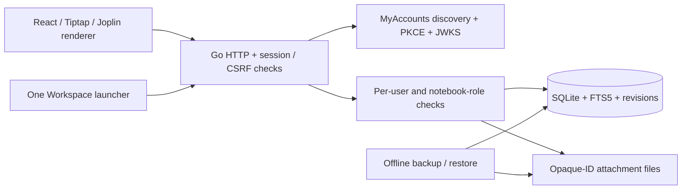

# Architecture

One Go process embeds a React/TypeScript frontend and serves HTTP. `modernc.org/sqlite`
provides pure-Go SQLite, FTS5, WAL journaling, foreign keys, a busy timeout and full
synchronous commits. No Joplin Electron process or separate runtime is required.
`cmd/notes` supplies CLI lifecycle, instance locking and kardianos Windows service
integration. `internal/app` holds identity, persistence, permissions, attachments,
administration and backup adapters. `web/src/*.aui` is the source UI tree compiled
to React by @codedia/parser; leaf adapters connect browser inputs and Tiptap.

## Persistence and concurrency

Notes use random 32-character hex IDs and canonical Markdown bodies; notebook,
tag, pin, star, archive, trash, reminder and template metadata is separate. Tags
are serialized JSON and included in the FTS index. Queries apply authorization
before returning matches. Lists return 100 rows and short previews; opening a note
loads its full body. Attachments are binary files keyed only by generated IDs.
User-supplied filenames are metadata, not filesystem paths.

Each note has a monotonic revision. Saves compare revisions and update within a
transaction, recording the previous content revision. A stale request receives
409. The frontend retains its draft and offers a separate recovered copy or the
server version. Browser autosave uses an 800 ms debounce and serializes in-flight
saves; further edits retain their own generation and server revision. Device
storage failure is reported and never treated as a successful local backup.

Writes are serialized to maintain quota checks and consistent attachment/backup
operations on a small SQLite deployment. Content history retains 50 revisions.
Logical quotas count current content, retained content history and attachments;
SQLite indexes/page overhead is additional disk space. Bulk UI actions perform
individual permission-checked, revision-protected writes and report successes.
They are not an atomic transaction across all selected notes.

Schema creation is transactional and repeatable. A later migration version is
rejected to prevent an unsupported downgrade; unrelated SQLite databases are
refused. SQLite checks and process locks protect startup, backups and restores.
Shutdown drains HTTP requests and checkpoints WAL. Tests also kill and restart a
native process and verify committed content and attachments.

## Identity and permissions

State, a browser binding, nonce and PKCE verifier are kept server-side with expiry.
The callback consumes them once, exchanges the code and verifies signature,
issuer, audience, expiry and nonce. Users are unique by `(issuer, subject)`.
The server stores hashed random session tokens and fixed expiries; cookies are
HttpOnly, SameSite=Lax, scoped to the app prefix and Secure over HTTPS. Browser
mutations require the configured Origin and a session CSRF token.

Notes are private to their owner unless their notebook has an explicit membership.
Viewer and editor access is checked on every note, history and attachment endpoint.
Notebook invitations are hashed, single-use and expire after 24 hours. Revocation
also removes outstanding invitations. Sharing a parent does not silently share
child notebooks. Admin roles are explicitly configured subjects at the same issuer;
admin endpoints manage quotas/accounts/settings and expose no private-note bypass.

## Recovery and interoperability

Personal exports contain owned notes, notebook hierarchy, tags, metadata and binary
attachments in a versioned ZIP/JSON format. Imports validate limits and hierarchy,
allocate fresh IDs and rewrite internal/resource links within a transaction.
Offline system backups snapshot SQLite and include attachments while the app is
stopped. Restore validates archive paths and database integrity and never overwrites
an existing database. Config and OIDC secret environment are restored separately.

Offline awareness means an already loaded editor retains device-local drafts and
retries after reconnection. It does not provide a fully cached application or
multi-device offline database. No service worker caches authenticated APIs.

Joplin reuse and boundaries are detailed in [JOPLIN.md](JOPLIN.md). Keep new sync or
encryption work in a separately tested adapter; never reinterpret this app's HTTP
autosave protocol as official Joplin synchronization.
